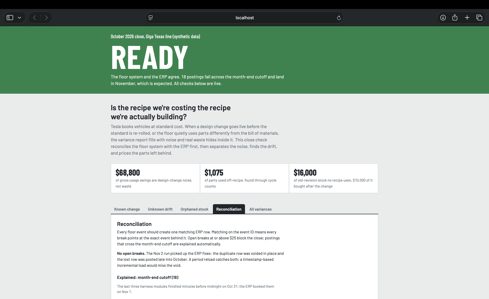
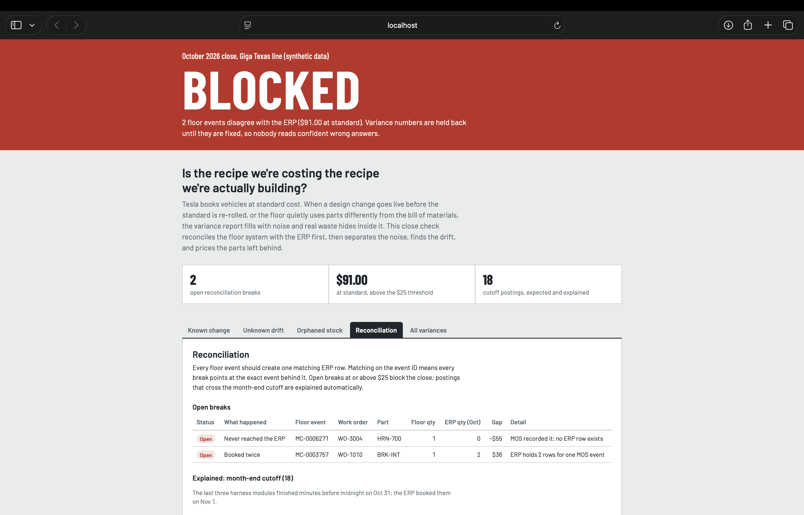
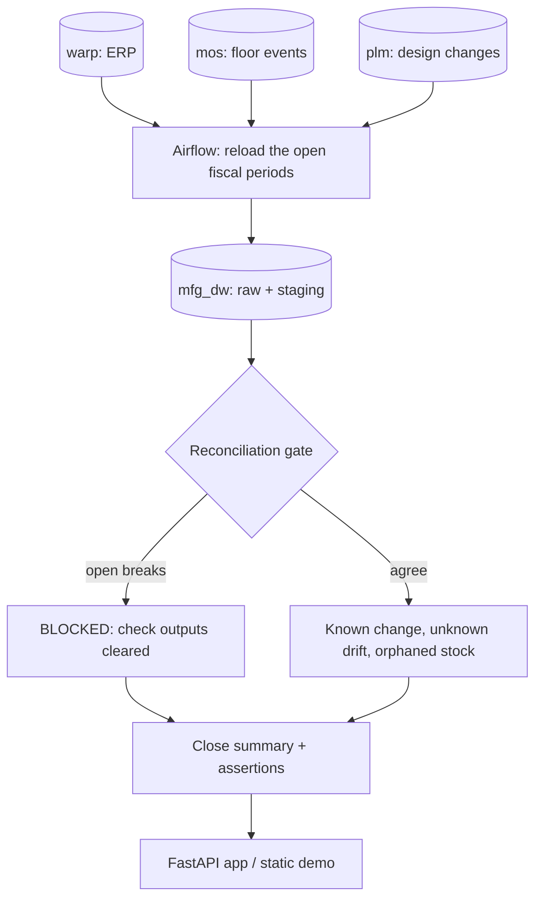
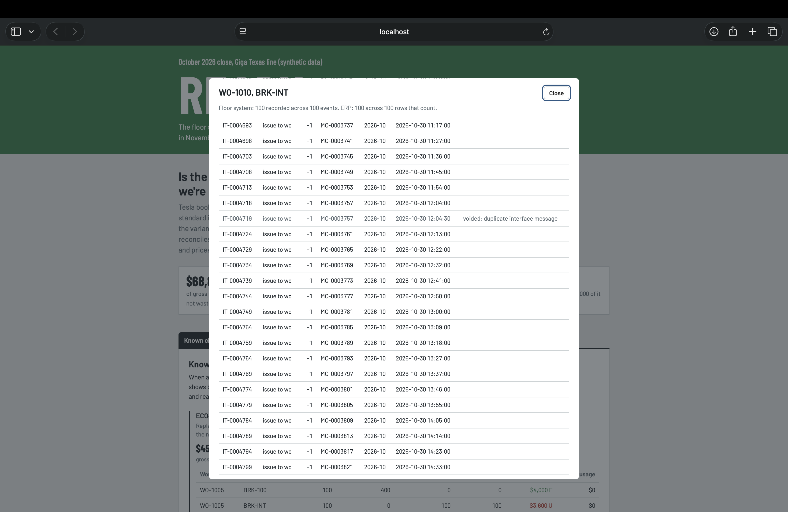

# Costed vs built

[](https://github.com/bananya007/costed-vs-built/actions/workflows/ci.yml)

A month-end close pipeline for manufacturing cost accounting. It reconciles the floor system against the ERP, then answers one question: **is the recipe we're costing the recipe we're actually building?**

Python · SQL · MySQL · Airflow · FastAPI · Docker · GitHub Actions

**[Live demo](https://bananya007.github.io/costed-vs-built/)**: click any row with a work order to see the floor events and ERP rows behind the number.



## The problem

Manufacturers carry inventory at standard cost: a fixed cost per unit, built from a frozen bill of materials (BOM). Every gap between that standard and what the line really does becomes a variance that has to be explained at month-end close. Three gaps are hard to see because each one spans several systems:

- **A design change goes live before the standard is re-rolled.** Usage variance swings by amounts that aren't waste, and real waste hides inside the swing.
- **The floor uses a part differently from the BOM.** Backflushed parts are recorded at BOM quantity by design, so the floor system always looks right. The truth only shows up in cycle-count shortages.
- **Parts removed by a change stay on the shelf,** sometimes still being purchased, until they surface as a write-down.

The sources are modeled on public information about Tesla: vehicles valued at standard cost ([10-K](https://www.sec.gov/Archives/edgar/data/1318605/000162828026003952/tsla-20251231.htm)), an in-house MySQL-backed ERP (Warp) alongside a separate floor system (MOS), a production ramp at Giga Texas, and $177M of inventory write-downs in H1 2026 ([10-Q](https://www.sec.gov/Archives/edgar/data/0001318605/000162828026049270/tsla-20260630.htm)).

## What it does

1. **Reconciliation gate.** Matches every floor event to its ERP rows. If the systems disagree beyond materiality, the close is BLOCKED and no variance numbers are published.
2. **Known change.** Splits each work order's usage variance into the design change itself and real usage, so real waste can't hide inside the change.
3. **Unknown drift.** Ties cycle-count shortages back to BOM lines and labels the likely cause: a wrong BOM quantity, unlogged losses, or a one-off.
4. **Orphaned stock.** Values old-revision parts that no recipe uses any more, and flags receipts dated after the change removed them.

The close summary also carries the standard variance pack (purchase price, labor rate and efficiency, overhead absorption), so the checks can be read in context.

## Results on the sample month

The sample month is October 2026 on one line: 3 sub-assemblies, 16 parts, 1,500 units and 2 design changes going live mid-month. Its data contains issues of the kind a real close turns up, so every output can be verified against a known answer.

**Nov 1 run: BLOCKED.** One interface message was booked twice ($36) and one never reached the ERP ($55). 18 postings that crossed the month-end cutoff are recognised as timing and don't block. On Nov 2 the ERP team voids the duplicate in place and posts the lost row late. The next run reloads the open periods, picks up both fixes, and the close turns READY.

| Check | Finding |
| --- | --- |
| Known change, ECO-0519 (4 brackets replaced by 1 integrated bracket) | $45,600 of gross swings reduce to a $2,400 design saving, plus $720 of real scrap that was hidden inside them |
| Known change, ECO-0533 (stamped frame replaced by a cast frame) | $23,200 of gross swings, net $800 saving, no real waste |
| Unknown drift, FOM-510 foam | 40 short across 2 of 4 counts, lumpy: likely losses not being logged ($600) |
| Unknown drift, CON-710 connector | 150 short, steady across 3 counts: BOM quantity likely wrong, about 5 per unit rather than 4 ($375) |
| Unknown drift, BRK-100 bracket | 10 short once: a one-off to investigate ($100) |
| Orphaned stock | $16,000 of old-revision parts no recipe uses, $10,000 of it received after the change removed the part |



## Why not the ERP's own variance report?

ERPs split variance by cause at month-end, inside one system, and PLM tools record what to do with old parts without the dollar impact. These checks need data from several systems at once: the change from PLM, the standard from the ERP, what was built from the floor system, and what is left in inventory. No single system holds all four.

## How it works



**Period reload, not a timestamp watermark.** Each run re-extracts the month being closed and the month after it, and replaces them in the warehouse; master data is small and fully reloaded. Late postings, cutoff entries and rows voided in place all land in an open period. A watermark would miss the void, because a voided row's timestamp never changes. The first run loads all history with `--full`. Every run logs what it loaded, for which periods, and the close result.

**Event-level reconciliation.** Every floor event (part used, part scrapped, unit built) should create exactly one ERP row, and that row carries the event's id in `source_event_id`. Matching on the id means every break names the event behind it. `TIMING` (booked in the next month) is explained automatically. `MISSING_IN_ERP`, `DUPLICATE`, `QTY_MISMATCH` and `MISSING_IN_MES` stay open, and open breaks of $25 or more block the close.



**Known change.** Per work order and part: the standard allows units × quantity on the revision frozen in the cost standard; the built revision calls for units × quantity on the revision each unit was actually built on. *(built − standard) × price* is the design change; *(actual − built) × price* is real usage, split into logged scrap and other usage.

**Unknown drift.** Each cycle-count shortage is compared with the recorded use since the previous count. A steady ratio across 3+ counts points to a wrong BOM quantity; shortages on some counts but not others point to unlogged losses; a single shortage is a one-off. The cause labels are heuristics and are reported as "likely".

**Orphaned stock.** Parts on a revision that a change order ended, and that weren't carried into the new revision: book quantity and value at month-end, days of supply if another recipe still uses them, and receipts dated after the change.

**Business logic in SQL, orchestration in Python.** The checks are plain SQL files in `sql/warehouse/`, readable and auditable by an analyst. Python moves the data, runs the files in order and decides BLOCKED or READY. Every Airflow task calls a plain function, so the CLI, the DAG and CI run the same code.

**Data quality checks that fail the run** (`sql/assertions/`):
- no duplicate BOM lines or standard costs (a duplicate would fan out the joins);
- every unit was built on a BOM revision that exists;
- every item that moved has a standard, and every sub-assembly has a frozen BOM revision (the checks join on it, so a gap would silently drop rows);
- every part id used anywhere exists in the item master;
- on a READY close, standard + every variance adds back to the usage booked in the ERP, and no material break is open.

**Tests.** `tests/test_close.py` runs the full story end to end: it generates the month, runs the close (blocked), applies the ERP fixes, runs it again (ready), compares every output with `generator/expected.json`, and checks the API. GitHub Actions runs it on every push, along with a check that the DAG imports in Airflow.

## Run it

With Docker:

```bash
docker compose up
```

This starts MySQL, loads the sample month, and starts Airflow on <http://localhost:8080> and the app on <http://localhost:8000>.
- The Airflow user is `admin`; the password is in `docker compose logs airflow | grep -i password`.
- Trigger `costed_vs_built` with `{"close_period": "2026-10", "full": true}`. The close is BLOCKED.
- Apply the Nov 2 fixes with `docker compose run --rm seed python -m generator.generate --corrections`, trigger the DAG again with `{"close_period": "2026-10"}`, and the close is READY.

Without Docker (needs MySQL 8):

```bash
pip install -r requirements.txt
export MYSQL_HOST=127.0.0.1 MYSQL_PASSWORD=<your password>
python -m generator.generate
python -m pipeline.run --close-period 2026-10 --full     # BLOCKED
python -m generator.generate --corrections
python -m pipeline.run --close-period 2026-10            # READY
pytest -v tests
uvicorn app.main:app --reload                            # http://localhost:8000
```

`scripts/build_demo.sh` rebuilds the static demo in `docs/`.

## Data and assumptions

| | |
| --- | --- |
| Standard costing for vehicles; H1 2026 write-downs | Tesla's 10-K and 10-Q, linked above |
| Warp as an in-house, MySQL-backed ERP; MOS as the floor system | Tesla job postings and press coverage |
| Every table, column, part, price, threshold and close step | A general manufacturing design, not Tesla's internal one |
| A PLM system as the source of change orders | Assumed; which PLM Tesla uses isn't public |
| Drift cause labels | Heuristics |

All data is synthetic.

## Scope and next steps

The current scope is one plant, one month and one cost version, with each part at one line-side location. Moving to production would mean:
- **Sources:** extract from read replicas or change streams of the ERP and floor system instead of one server; the code already takes separate `SOURCE_*` and `DW_*` connection settings.
- **Scale:** partition warehouse tables by fiscal period so a period reload becomes a partition swap, and run the same DAG on Kubernetes with the pipeline in its own image.
- **Tuning:** set the materiality and drift thresholds from real data.
- **Coverage:** trends across periods and cost versions, shared parts across sub-assemblies, and posting the classified variances to the GL as journal entries.

## Layout

```
generator/      sample month and expected.json (the known answers)
sql/sources/    warp, mos, plm schemas
sql/warehouse/  staging, reconciliation gate, the checks, close summary
sql/assertions/ data quality checks that fail the run
pipeline/       extract, transform steps, export, CLI
dags/           Airflow DAG
app/            FastAPI app and the page
docs/           static demo for GitHub Pages
tests/          end-to-end test
```

B P Gayathri Ananya · [GitHub](https://github.com/bananya007)
